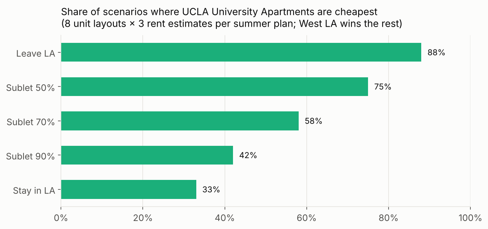
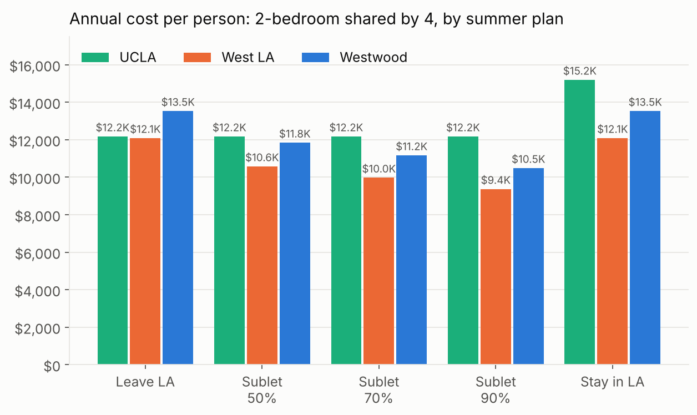

# UCLA 학생은 어디에 살아야 가장 쌀까?
**UCLA University Apartments vs Westwood (90024) vs West LA (90025) 1인당 주거 비용 분석**

기준 시점: 2026년 10월 렌트, 2026-27 UCLA 요금 · 도구: DuckDB SQL, Python · 데이터: Zillow ZORI, HUD SAFMR FY2026, UCLA Housing 공식 요금표

---

## 요약

1. **결론을 가르는 변수는 지역이 아니라 "여름 계획"이다.** 여름에 LA를 떠나는 학생은 120개 비교 중 88%에서 UCLA University Apartments가 가장 쌌다(이길 때 중앙값 연 $3,412 차이). 외부 아파트는 12개월 계약이라 비어 있는 여름 월세도 내기 때문이다.
2. **두 번째 변수는 몇 명이 한 집을 쓰느냐다.** 2인 이하는 거의 모든 시나리오에서 UCLA가 쌌고, 4인이 2베드를 쓰면서 여름에 서브렛하거나 LA에 남으면 모든 시나리오에서 West LA가 쌌다.
3. **Westwood는 어떤 시나리오에서도 가장 싸지 않았고, 그 격차는 커지고 있다.** West LA 대비 프리미엄이 2018년 8%에서 2026년 13%로 늘었다. Westwood는 "통학 시간을 돈으로 사는 선택"이며, 시간 가치를 시간당 $15~24 이상으로 보는 학생에게만 합리적이다.

---

## 1. 문제 정의

**의사결정자**: 기숙사 계약이 끝나 거주지를 다시 정해야 하는 UCLA 학생 (편입생, 3~4학년, 대학원생)
**결정**: UCLA University Apartments에 남을지, 캠퍼스 옆 Westwood나 조금 떨어진 West LA에서 렌트할지

**주 지표: 1인당 연간 주거비**
- 유닛 렌트를 거주 인원으로 나눠, 1인당 요금인 UCLA와 같은 기준으로 맞췄다.
- UCLA는 약 9개월 학년도 계약, 외부 아파트는 보통 12개월 계약이다. 월평균만 비교하면 이 차이가 가려지기 때문에 **연간 총비용**을 주 지표로 쓰고, 여름 계획별로 나눠 계산했다.
- 통학 시간은 정답이 없는 시간 가치 대신 **손익분기 시간 가치**로 표현했다.

자세히: [docs/01_problem_definition.md](docs/01_problem_definition.md)

## 2. 데이터

| 데이터 | 내용 | 역할 |
| --- | --- | --- |
| Zillow ZORI | ZIP별 월별 시장 렌트 지수 (침실 구분 없음) | 지역 간 수준 차이, 추이 |
| HUD SAFMR FY2026 | ZIP × 침실 수별 기준 렌트 (공과금 포함, 40번째 백분위수) | 침실 수에 따른 렌트 비율 |
| UCLA Housing 2026-27 | University Apartments 1인당 학년도 요금 8개 유형 | 대학 주거 비교 기준 |

**품질 점검에서 내린 주요 판단**
- **두 출처의 일치도**: 서부 LA 8개 ZIP에서 ZORI와 SAFMR 1BR의 상관계수 0.93. 지역 간 순서는 두 출처가 거의 같다.
- **SAFMR의 한계**: SAFMR은 90024와 90025를 1BR $3,450 vs $3,440으로 거의 같게 보지만, ZORI로는 Westwood가 약 12% 비싸다. → **ZIP 수준은 ZORI, 침실 수 비율은 SAFMR**에서 가져와 결합했다.
- **기간 불일치**: UCLA는 학년도, 외부는 12개월. 여름 계획 시나리오로 처리했다.
- **요금표 불일치**: UCLA 2베드 3인 공유 유형의 분기 납부액 합계가 공식 총액보다 $404 적다. 공식 총액을 쓰고 로그에 기록했다.

자세히: [docs/02_data_collection.md](docs/02_data_collection.md), [data/README.md](data/README.md)

## 3. 방법

1. **추정 시장 렌트** (`sql/03`): `최신 ZORI(zip) × SAFMR(zip, 침실) ÷ SAFMR(zip, 1BR)`
2. **같은 조건 비교** (`sql/04`): UCLA 각 유형을 침실 수와 인원이 같은 외부 아파트와 1인당 비용으로 비교
3. **민감도 분석** (`sql/06~08`): 불확실한 가정 두 가지를 동시에 바꿈
   - 렌트 추정 방식 3가지: ZORI 보정 / SAFMR 그대로(보수적) / SAFMR × 1.1
   - 여름 계획 5가지: LA를 떠남 / 서브렛 50·70·90% 회수 / LA에 남음
   - 3 × 5 = 15개 시나리오 × UCLA 유형 8개 = **120개 비교**. 세 추정 방식에서 모두 같은 선택이 이기면 "robust"로 판정
4. **추이** (`sql/02, 09, 10`): 2018년 이후 월별·연도별 렌트와 프리미엄, 계절성

모든 쿼리는 `python scripts/03_run_sql.py`로 재현된다.

## 4. 발견

### 발견 1. 여름 계획이 승자를 바꾼다

| 여름 계획 | UCLA가 가장 쌈 | 이길 때 중앙값 차이 (UCLA / West LA) |
| --- | --- | --- |
| LA를 떠남 | 88% | $3,412 / $87 |
| 서브렛 50% | 75% | $1,839 / $262 |
| 서브렛 70% | 58% | $1,487 / $240 |
| 서브렛 90% | 42% | $1,089 / $108 |
| LA에 남음 | 33% | $1,359 / $42 |

UCLA는 **이길 때 크게, West LA는 이길 때 근소하게** 이긴다. 횟수가 비슷해 보이는 서브렛 70%에서도, UCLA를 골랐다가 틀렸을 때의 손해는 반대 경우보다 훨씬 작다.

### 발견 2. 인원이 많을수록 외부 아파트가 유리하다

2베드를 4명이 쓰는 경우, LA를 떠나면 UCLA($12.2K)와 West LA($12.1K)가 사실상 같고, 서브렛하거나 LA에 남으면 West LA가 연 $1,600~3,100 싸다(주 추정 기준). 보수적인 SAFMR 기준으로 바꾸면 LA를 떠나는 경우 UCLA가 $700~2,000 싸진다.
외부 아파트는 인원이 늘수록 1인당 비용이 빠르게 내려가지만, UCLA 요금은 인원이 늘어도 그만큼 내려가지 않는다. 반대로 스튜디오 2인과 1베드 2인은 모든 시나리오에서 거의 UCLA가 쌌다.

### 발견 3. Westwood는 비용으로는 한 번도 이기지 못했고, 격차는 커지고 있다

- 외부가 이길 때는 항상 West LA였다.
- 2018년 대비 Westwood +26%, West LA +20%. 연평균 프리미엄은 8.0%(2018) → 13.4%(2026).
- 프리미엄에는 계절성이 있다. 5월은 9년 모두 그해 평균보다 높았고(평균 +1.5%p), 11월이 가장 낮았다(-1.1%p).
- **통학 손익분기**: West LA는 Westwood보다 1인당 월 $120~194 싸다. 편도 15분, 월 16일 통학을 가정하면 추가 통학은 월 8시간이므로, 시간 가치가 **시간당 $15~24**보다 높을 때만 Westwood가 낫다.

## 5. 추천

| 여름 계획 | 2인 이하 | 3인 | 4인 |
| --- | --- | --- | --- |
| LA를 떠남 | **UCLA** | **UCLA** | UCLA (주 추정으론 비슷) |
| 서브렛 가능 (70% 이상 회수) | **UCLA** | 비슷함 (차이 작음) | **West LA** |
| LA에 남음 | **UCLA** | West LA (추정 방식에 따라 다름) | **West LA** |

- **외부를 고른다면** 비용만 보면 West LA. 통학 시간을 시간당 $15~24 이상으로 평가하면 Westwood.
- **Westwood로 간다면** 프리미엄이 높은 4~6월보다 가을~겨울 계약이 상대적으로 유리하다.

**UCLA Housing 관점의 시사점**: 2인 이하 유형은 외부 대비 가격 경쟁력이 커서 수요가 몰릴 가능성이 높고, 4인 공유 유형은 외부 West LA보다 비싸 학생이 빠져나갈 위험이 크다. 4인 유형의 가격 조정이나 여름 단기 계약 옵션을 실험해 볼 만하다.

## 6. 한계

- **외부 렌트는 ZIP 단위 추정치**다. 특히 "ZORI ≈ 1베드 렌트" 가정에 따라 두 지역 차이가 달라지며, 이를 보완하려고 SAFMR 그대로 쓴 보수적 시나리오를 함께 돌렸다.
- **가정값**: UCLA 계약 9개월, 서브렛 회수율, 통학 시간(편도 +15분)은 가정이다. 여름 서브렛 수요는 실제로 불확실하다.
- **반영하지 않은 비용**: 보증금, 가구, 공과금 차이(UCLA 요금 포함 여부 미확인), 주차.
- **배정 가능성**: UCLA University Apartments는 신청한다고 모두 배정되지 않는다. 이 분석은 "배정된다면"을 가정한다.
- **v1 데이터는 쓰지 않았다**: 처음 버전의 스크래핑 데이터는 일부가 합성이라 전부 폐기했다. [archive/v1](archive/v1/README.md)

## 7. 다음 단계

- 실제 매물 표본을 출처를 밝혀 소량 수집해 추정 렌트의 오차를 측정
- UCLA 요금의 공과금·가구 포함 여부를 확인해 비교 기준 보정
- 룸메이트 수, 여름 계획, 시간 가치를 입력하면 추천을 보여주는 대시보드
