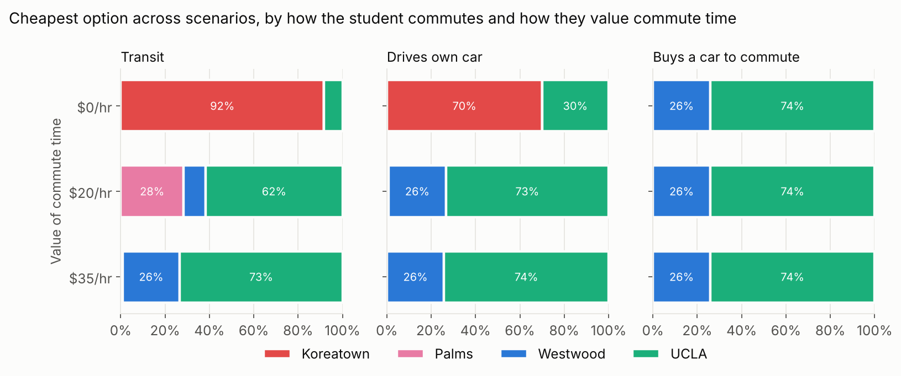
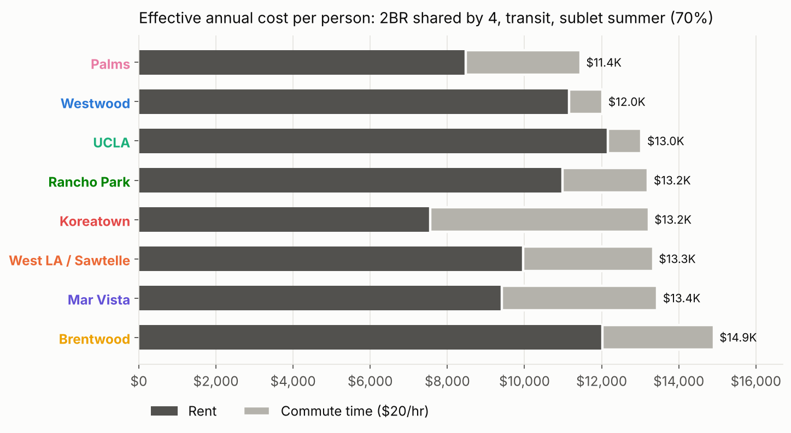
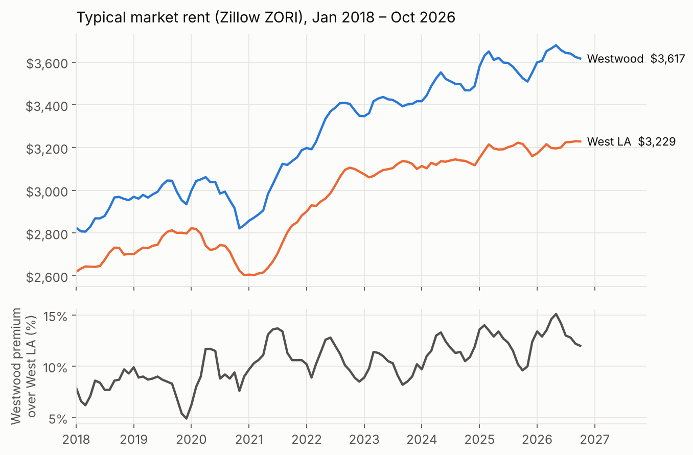

# UCLA 학생은 어디에 살아야 가장 합리적일까?
**UCLA University Apartments vs 캠퍼스 주변 7개 동네: 렌트 + 통학 비용 분석**

기준 시점: 2026년 10월 렌트, 2026-27 UCLA 요금, 2026년 11월 구글맵 통학 시간 · 도구: DuckDB SQL, Python · 데이터: Zillow ZORI, HUD SAFMR FY2026, UCLA Housing·Transportation 공식 요금, AAA Your Driving Costs 2026, Google Maps

---

## 요약

1. **렌트만 보면 Koreatown이 가장 싸지만, 통학 시간을 계산에 넣으면 그 이점은 사라진다.** 통학 시간을 0원으로 보면 대중교통 이용자 기준 시나리오의 92%에서 Koreatown이 가장 쌌다. 시간을 시급 $20로 평가하면 Koreatown은 한 번도 가장 싸지 않았다. Koreatown이 UCLA 아파트보다 유리하려면 통학 시간을 시간당 약 $13~19 이하로 평가해야 한다.
2. **차로 통학한다고 먼 동네가 싸지지 않는다.** 구글맵 기준 Koreatown은 차로 가도 대중교통(59분)보다 빠르지 않았고(보통 35~80분), 주차비와 운행비로 월 약 $200가 더 든다. **먼 동네에 살려고 차를 사는 경우는 시간을 0원으로 봐도 모든 시나리오에서 손해**였다.
3. **대중교통 이용자에게 가장 가성비 좋은 동네는 Palms다.** 2베드 4인, 여름 서브렛, 시급 $20 기준 실질 비용이 연 $11.4K로 Westwood($12.0K)와 UCLA($13.0K)보다 낮았다. 렌트는 Westwood보다 24% 싸고 통학은 대중교통 31분이다.
4. **여름 계획은 여전히 UCLA 아파트와 외부 아파트 사이의 승부를 가른다.** 외부 아파트는 12개월 계약이라, 여름에 LA를 떠나는 학생에게는 UCLA 아파트가 유리하다.

---

## 1. 문제 정의

**의사결정자**: 기숙사 계약이 끝나 거주지를 다시 정해야 하는 UCLA 학생 (편입생, 3~4학년, 대학원생)
**선택지**: UCLA University Apartments, 그리고 캠퍼스 주변 7개 동네 — Westwood(90024), West LA/Sawtelle(90025), Rancho Park(90064), Brentwood(90049), Palms(90034), Mar Vista(90066), Koreatown(90005)

**주 지표: 1인당 연간 실질 비용**
```
실질 비용 = 렌트 (여름 계획 반영) + 통학 현금 비용 (주차·운행·차량 보유) + 통학 시간 × 시간 가치
```
- 유닛 렌트를 거주 인원으로 나눠, 1인당 요금인 UCLA와 같은 기준으로 맞췄다.
- UCLA는 약 9개월 학년도 계약, 외부는 보통 12개월 계약이라 연간 총비용으로 비교했다.
- 통학 시간 가치는 사람마다 다르므로 $0 / $20 / $35 세 값으로 보고, 동네별 **손익분기 시간 가치**를 따로 계산했다.

자세히: [docs/01_problem_definition.md](docs/01_problem_definition.md)

## 2. 데이터

| 데이터 | 내용 | 역할 |
| --- | --- | --- |
| Zillow ZORI | ZIP별 월별 시장 렌트 지수 (침실 구분 없음) | 동네 간 렌트 수준, 추이 |
| HUD SAFMR FY2026 | ZIP × 침실 수별 기준 렌트 | 침실 수에 따른 렌트 비율 |
| UCLA Housing 2026-27 | University Apartments 1인당 요금 8개 유형 | 대학 주거 비교 기준 |
| Google Maps (2026-11 조회) | 동네별 대중교통·운전 시간, 운전 거리 (평일 오전 9시 도착) | 통학 시간 |
| UCLA Transportation | 통학생 주차권 분기 $340.23, 학부생 대중교통 무료 (Bruin U-Pass) | 통학 현금 비용 |
| AAA Your Driving Costs 2026 | 마일당 연료 17.32¢ + 정비 11.73¢, 소형 세단 연간 총비용 $9,259 | 차량 운행·보유 비용 |

**품질 점검에서 내린 주요 판단**
- **두 출처의 일치도**: 8개 ZIP에서 ZORI와 SAFMR 1BR의 상관계수 0.93.
- **SAFMR의 한계**: SAFMR은 인접 ZIP을 잘 구분하지 못한다(Westwood $3,450 vs Sawtelle $3,440). → **ZIP 수준은 ZORI, 침실 수 비율은 SAFMR**에서 가져와 결합했다.
- **이상치 제외**: Koreatown 90020은 ZORI가 SAFMR의 0.76배로 다른 ZIP과 크게 달라 비용 분석에서 제외하고 교차 검증에만 썼다.
- **기간 불일치**: UCLA는 학년도, 외부는 12개월 → 여름 계획 시나리오로 처리했다.

자세히: [docs/02_data_collection.md](docs/02_data_collection.md), [data/README.md](data/README.md)

## 3. 방법

1. **추정 시장 렌트** (`sql/03`): `최신 ZORI(zip) × SAFMR(zip, 침실) ÷ SAFMR(zip, 1BR)`
2. **같은 조건 비교** (`sql/04`): UCLA 각 유형을 침실 수와 인원이 같은 외부 아파트와 1인당 비용으로 비교
3. **통학 비용** (`sql/05`): 동네 × 수단(도보 / 대중교통 / 보유 차량 / 새로 산 차량)별 월 통학 시간과 현금 비용
   - 대중교통: 요금 0 (학부생 Bruin U-Pass는 거주지와 무관하게 모든 학생이 학생회비로 부담)
   - 보유 차량: UCLA 주차권 + 마일당 운행비. 운전 시간은 구글맵 범위의 중간값 + 주차·도보 10분
   - 새로 산 차량: 위 비용 + 보유비(AAA 소형 세단 총비용 − 운행비 = 월 약 $408)
4. **민감도 분석** (`sql/06~08`): 네 가지 가정을 동시에 바꿈
   - 렌트 추정 방식 3 × 여름 계획 5 × 통학 방식 3 × 시간 가치 3 = 135개 시나리오 × UCLA 유형 8개 = **1,080개 비교**
5. **손익분기 시간 가치** (`sql/11`): 각 동네가 UCLA 아파트보다 싸지는 시간 가치의 상한
6. **추이** (`sql/02, 09, 10`): 2018년 이후 동네별 렌트, Westwood 프리미엄, 계절성

모든 쿼리는 `python scripts/03_run_sql.py`로 재현된다.

## 4. 발견

### 발견 1. 통학 시간을 계산에 넣는 순간 승자가 바뀐다



| 통학 방식 | 시간 가치 $0 | $20/hr | $35/hr |
| --- | --- | --- | --- |
| 대중교통 | **Koreatown 92%**, UCLA 8% | UCLA 62%, **Palms 28%**, Westwood 10% | UCLA 73%, Westwood 26% |
| 보유 차량 | **Koreatown 70%**, UCLA 30% | UCLA 73%, Westwood 26% | UCLA 74%, Westwood 26% |
| 차량 구입 | UCLA 74%, Westwood 26% | UCLA 74%, Westwood 26% | UCLA 74%, Westwood 26% |

(각 칸 = 해당 조건의 120개 시나리오에서 가장 싼 선택의 비율)

**손익분기 시간 가치 (2베드 4인, 대중교통, UCLA 아파트 대비)**

| 동네 | 여름에 떠남 | 여름 서브렛 70% |
| --- | --- | --- |
| Palms | $17.9/hr | $35.0/hr |
| Koreatown | $12.6/hr | $19.2/hr |
| West LA / Sawtelle | $0.7/hr | $17.6/hr |
| Mar Vista | $4.8/hr | $17.4/hr |
| Rancho Park | 항상 UCLA가 쌈 | $17.5/hr |
| Brentwood | 항상 UCLA가 쌈 | $1.4/hr |

예: 여름에 서브렛하는 학생이 통학 시간을 시간당 $19.2보다 낮게 본다면 Koreatown이, 그보다 높게 본다면 UCLA 아파트가 싸다. Koreatown은 연 $4,619의 렌트를 아끼는 대신 통학이 연 240시간 늘어난다.

### 발견 2. 차는 먼 동네의 해결책이 아니다

| 동네 | 대중교통 (분) | 운전 (구글맵 "보통", 분) | 운전 거리 | 차량 통학 현금 비용 (학기 중 월) | 운전이 이득인 시간 가치 |
| --- | --- | --- | --- | --- | --- |
| Westwood | 도보 9 | | 0.4마일 (도보) | | |
| Rancho Park | 23 | 12~20 | 3.5마일 | $146 | 운전이 더 느림 |
| Brentwood | 30 | 7~18 | 3.0마일 | $141 | $35/hr 이상 |
| Palms | 31 | 14~28 | 5.3마일 | $163 | 시간 절약 없음 |
| West LA / Sawtelle | 35 | 9~18 | 3.0마일 | $141 | $23/hr 이상 |
| Mar Vista | 42 | 14~30 | 6.0마일 | $169 | $32/hr 이상 |
| Koreatown | 59 | 35~80 | 9.4마일 | $201 | 운전이 더 느림 |

(운전 시간 = 구글맵 "보통" 범위의 중간값 + 주차·도보 10분으로 계산)

- **Koreatown은 차로 가도 대중교통보다 빠르지 않았다**(운전 중간값 57분 + 주차·도보 10분 vs 대중교통 59분). 차를 쓰면 시간은 그대로이고 월 $201가 더 든다.
- 운전이 대중교통보다 빠른 곳(Sawtelle, Brentwood, Mar Vista)도 7~12분 빠른 정도라, 주차비($113/월)와 운행비를 감안하면 시간 가치가 시간당 $23~35 이상일 때만 운전이 이득이다.
- 이 동네에 살기 위해 차를 새로 사면 보유비가 월 약 $408 더해져, **시간을 0원으로 봐도 외부 동네가 UCLA 아파트나 Westwood보다 싼 시나리오는 하나도 없었다.**

### 발견 3. 대중교통 이용자에게는 Palms가 가성비가 가장 좋다



2베드 4인, 여름 서브렛 70%, 대중교통, 시급 $20 기준:
- **Palms $11.4K** < Westwood $12.0K < UCLA $13.0K < Rancho Park $13.2K ≈ Koreatown $13.2K < Sawtelle $13.3K < Mar Vista $13.4K < Brentwood $14.9K
- Koreatown은 렌트가 가장 싸지만(연 $7.5K) 통학 시간 비용(연 $5.7K)이 대부분 상쇄한다.
- Westwood는 렌트가 비싸도 도보 9분이라 통학 비용이 거의 없어, 시간을 중시할수록 외부 동네 중 가장 유리해진다.

### 발견 4. 여름 계획은 UCLA 아파트 vs 외부 아파트를 가른다

같은 조건(대중교통, 시급 $20)에서 여름에 LA를 떠나면 UCLA($13.0K)가 Palms($13.2K)와 Westwood($14.4K)보다 싸다. 외부 아파트는 12개월 계약이라 비어 있는 여름 월세도 낸다. 서브렛으로 여름 월세를 회수할 수 있을수록 외부 아파트가 유리해진다.

### 발견 5. 렌트 추이: Brentwood는 가장 빨리, Koreatown은 가장 느리게 올랐다



| 동네 | 2018 평균 | 2026 평균 (1~10월) | 2018 대비 |
| --- | --- | --- | --- |
| Brentwood | $2,863 | $3,842 | +34% |
| Westwood | $2,888 | $3,638 | +26% |
| Mar Vista | $2,413 | $3,008 | +25% |
| Rancho Park | $2,846 | $3,544 | +24% |
| Palms | $2,250 | $2,731 | +21% |
| West LA / Sawtelle | $2,673 | $3,209 | +20% |
| Koreatown | $2,192 | $2,435 | +11% |

- 2020~2021년 정체 후 2022년에 모든 동네가 급등했다.
- 다른 6개 동네 평균 대비 Westwood 프리미엄에는 계절성이 있다. 5월은 9년 모두 그해 평균보다 높았고(평균 +1.1%p), 11월이 가장 낮았다(-1.2%p).

## 5. 추천

**먼저 두 가지를 정한다: 여름 계획, 그리고 통학 시간을 시간당 얼마로 볼지.**

| 상황 | 추천 |
| --- | --- |
| 여름에 LA를 떠나고, 통학 시간을 $20/hr 이상으로 본다 | **UCLA 아파트** |
| 여름에 서브렛·체류, 대중교통, 시간 가치 중간(~$20/hr) | **Palms** (가성비 최고). 다음은 Westwood |
| 여름에 서브렛·체류, 시간을 중시($35/hr 수준) | **Westwood** 또는 UCLA 아파트 |
| 통학 시간을 거의 신경 쓰지 않는다 | **Koreatown** (렌트 최저). 단 대중교통 편도 약 1시간 |
| 먼 동네에 살려고 차를 살 계획이다 | **사지 않는 것을 추천.** 어떤 시나리오에서도 손해 |

**UCLA Housing 관점의 시사점**: UCLA 아파트는 1,080개 시나리오 중 60%에서 가장 쌌다. 그러나 4인 공유 유형은 서브렛이 가능한 학생에게 Palms 같은 외부 동네보다 비싸, 이 학생들이 빠져나갈 위험이 있다. 4인 유형의 가격 조정이나 여름 단기 계약 옵션을 실험해 볼 만하다.

## 6. 한계

- **외부 렌트는 ZIP 단위 추정치**다. "ZORI ≈ 1베드 렌트" 가정을 보완하려고 SAFMR 기반 시나리오를 함께 돌렸다.
- **통학 시간은 동네별 대표 지점 하나**에서 잰 값이다. 같은 동네 안에서도 위치에 따라 크게 다를 수 있고, 요일·계절별 교통 차이는 반영하지 않았다.
- **UCLA 주차권은 보장되지 않는다.** 2026년 1월부터 일일 학생 주차권도 크게 제한됐다. 차량 통학 시나리오는 주차권을 받는다고 가정한다.
- **차량 비용은 AAA 신차 기준 전국 평균**이다. LA 기름값은 더 비싸고, 학생 중고차의 보유비는 더 낮을 수 있다. 집 근처 주차비는 반영하지 않았다.
- **가정값**: UCLA 계약 9개월, 서브렛 회수율, 월 16일 통학, 운전 시 주차·도보 10분.
- **반영하지 않은 요소**: 보증금, 가구, 공과금 차이, 동네의 생활 편의·안전, UCLA 아파트 배정 가능성.
- **v1 데이터는 쓰지 않았다**: 처음 버전의 스크래핑 데이터는 일부가 합성이라 전부 폐기했다. [archive/v1](archive/v1/README.md)

## 7. 다음 단계

- 동네 안 여러 지점에서 통학 시간을 재서 범위로 표시
- 실제 매물 표본을 출처를 밝혀 소량 수집해 추정 렌트의 오차 측정
- 여름 계획, 통학 방식, 시간 가치를 입력하면 추천을 보여주는 대시보드
