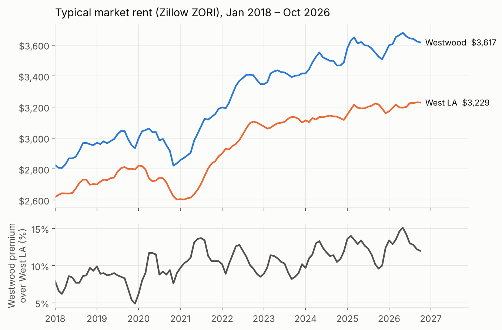

# 5단계. 렌트 추이 분석

쿼리: `sql/02_zori_trend.sql` (월별), `sql/09_trend_summary.sql` (연도별) · 차트: `images/01_rent_trend.png`
기간: 2018-01 ~ 2026-10 (모든 ZIP에 값이 있는 기간)

| 연도 | Westwood 평균 | West LA 평균 | Westwood 증가율 | West LA 증가율 | Westwood 프리미엄 |
| --- | --- | --- | --- | --- | --- |
| 2018 | $2,888 | $2,673 | | | 8.0% |
| 2019 | $2,987 | $2,764 | +3.4% | +3.4% | 8.1% |
| 2020 | $2,978 | $2,726 | -0.3% | -1.4% | 9.2% |
| 2021 | $3,028 | $2,715 | +1.7% | -0.4% | 11.5% |
| 2022 | $3,328 | $3,011 | +9.9% | +10.9% | 10.5% |
| 2023 | $3,406 | $3,100 | +2.3% | +3.0% | 9.9% |
| 2024 | $3,490 | $3,128 | +2.5% | +0.9% | 11.5% |
| 2025 | $3,583 | $3,194 | +2.7% | +2.1% | 12.2% |
| 2026 (1~10월) | $3,638 | $3,209 | +1.5% | +0.5% | 13.4% |

## 발견
1. **2018년 대비 Westwood +26%, West LA +20%.** 같은 기간 Westwood가 더 빨리 올랐다.
2. **Westwood 프리미엄이 커지는 추세다.** 연평균 기준 2018년 8.0% → 2026년 13.4%. 월별로는 2026년 5월 15.1%가 최고.
3. **2020~2021년 정체 후 2022년 급등.** 팬데믹 기간 원격 수업으로 캠퍼스 수요가 줄었다가, 대면 수업 재개와 함께 두 지역 모두 약 10% 올랐다. 2021년 초 Westwood 렌트는 2019년 수준 아래로 떨어지기도 했다.
4. **프리미엄에는 계절성이 있다.** (`sql/10_premium_seasonality.sql`) 매달의 프리미엄을 그해 평균과 비교하면(장기 추세 제거), 4~6월은 평균보다 높고 9~11월은 낮다. 특히 **5월은 9년 모두 그해 평균보다 높았고**(평균 +1.5%p), 11월은 평균 -1.1%p로 가장 낮았다. 가을 학기 계약이 몰리는 봄에 캠퍼스 인접 지역 수요가 먼저 오르는 것으로 해석할 수 있다(가설).

## 의사결정에 주는 의미
- 4단계에서 Westwood는 비용으로 한 번도 가장 싼 선택이 아니었는데, 추이까지 보면 **그 격차는 앞으로 더 벌어질 가능성**이 있다.
- 외부 아파트를 고른다면 계약 시점도 변수다. Westwood를 고른다면 프리미엄이 가장 높은 4~6월보다 9~11월에 계약할 때 West LA 대비 격차가 약 2~3%p 작다. 다만 학생 계약은 대부분 가을 학기 전에 몰려 있어 시점을 고를 여지가 작을 수 있다.

## 한계
- ZORI는 평활화된 지수라 실제 월별 변동보다 부드럽게 나타난다.
- 계절성은 연평균 대비 차이의 월별 평균으로만 확인했다. 정식 계절 분해(STL 등)는 하지 않았고, 9년치라 표본이 작다.
- 팬데믹 해석은 외부 맥락에 기반한 가설이다.
